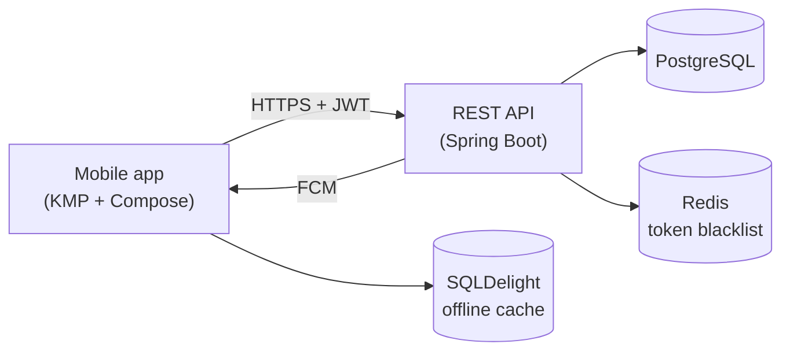

  

<h1 align="center">DatePlan</h1>

  <b>Plan, live and remember moments together.</b> 
  <i>Planejando momentos juntos.</i>

  <a href="⟨LINK_GOOGLE_PLAY⟩">Google Play</a> ·
  <a href="https://dateplanapp.netlify.app">Website</a> ·
  <a href="mailto:mayckgomes.dev@gmail.com">Contact</a>

---

DatePlan is an app for couples to plan dates, keep shared memories and count the
days together. It is built end to end by a solo developer, and every part of it
(app, API and website) is developed in the open here.

## Repositories

| Repository | What it is | Main tech |
|---|---|---|
| [**DatePlan**](https://github.com/DatePlanApplication/DatePlan) | Mobile app. Android is on Google Play; iOS is experimental. | Kotlin Multiplatform, Compose Multiplatform |
| [**dateplan-api-v2**](https://github.com/DatePlanApplication⟩/dateplan-api-v2) | Backend REST API: auth, couples, dates, memories, notifications. | Spring Boot, PostgreSQL, Redis |
| [**Dateplan-Web**](https://github.com/DatePlanApplication/DatePlan-Web⟩) | Website, privacy policy and terms of use. | ⟨STACK_DO_SITE⟩ |

## How the pieces fit

## Highlights

- **Offline-first app:** data is cached locally and the app tells "no internet"
  apart from "server unavailable".
- **Shared code:** one Kotlin codebase for UI and logic on Android and iOS.
- **Security-minded backend:** JWT with refresh-token rotation, Argon2id
  password hashing, Redis token blacklist, rate limiting behind NGINX.
- **Automated delivery:** GitHub Actions builds and deploys the API.

## Tech stack

**App:** Kotlin · Compose Multiplatform · Ktor · Koin · SQLDelight · Firebase
**API:** Java · Spring Boot · Spring Security · Flyway · PostgreSQL · Redis
**Infra:** Oracle Cloud · NGINX · systemd · GitHub Actions

## Status

| Area | State |
|---|---|
| Android app | Live on Google Play |
| iOS app | Experimental, in progress |
| API | In production |
| Open source | Being opened gradually, starting with the app |

## Contributing

Issues and pull requests are welcome.

1. Read the `CONTRIBUTING.md` of the repository you want to help with.
2. Look for issues labelled `good first issue`.
3. For vulnerabilities, **do not open a public issue**. Follow the
   `SECURITY.md` of the repository instead.

Everyone taking part follows our Code of Conduct.

## License

Code is released under the **MIT License** (see each repository).
The DatePlan name, logo and animations are not covered by the license.

<b>🇧🇷 Em português</b>

O **DatePlan** é um app para casais planejarem encontros, guardarem memórias e
contarem os dias juntos. Foi criado por um desenvolvedor solo, e app, API e
site são desenvolvidos de forma aberta aqui.

- **App:** Kotlin Multiplatform + Compose Multiplatform (Android na Google Play; iOS em desenvolvimento)
- **API:** Spring Boot, PostgreSQL e Redis
- **Contribuir:** leia o `CONTRIBUTING.md` de cada repositório. Para falhas de
  segurança, use o `SECURITY.md` em vez de abrir uma issue pública.

