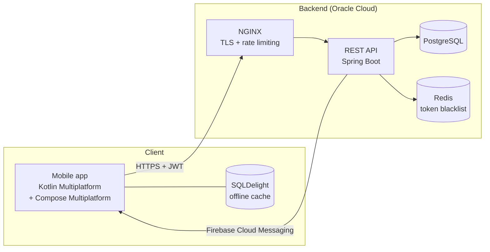

  

<h1 align="center">DatePlan</h1>
 

  <b>Plan, live and remember moments together.</b> 
  <i>Planejando momentos juntos.</i>

  <a href="https://play.google.com/store/apps/details?id=mayckgomes.com.dateplan">Google Play</a> ·
  <a href="https://dateplanapp.netlify.app">Website</a> ·
  <a href="mailto:mayckgomes.dev@gmail.com">Contact</a>

  <a href="#why-dateplan">Why</a> ·
  <a href="#what-it-does">What it does</a> ·
  <a href="#how-its-built-in-short">How it's built</a> ·
  <a href="#projects">Projects</a> ·
  <a href="#contributing">Contributing</a> ·
  <a href="#license">License</a>

## Why DatePlan
 
Couples share a lot: plans, dates, small rituals and memories. Yet that shared
life usually ends up scattered across chat threads, calendar apps and photo
galleries that were never designed for two people.
 
DatePlan gives a couple **one private place** built around their relationship:
 
- **Past:** keep the memories that matter.
- **Present:** see how long you have been together, every day.
- **Future:** plan the next date and get reminded in time.
It is also a real, end-to-end product: mobile app, backend, infrastructure and
website, designed, built and operated by a solo developer. This organization is
where that work is shared in the open.
 
## What it does
 
| | |
|---|---|
| 📅 **Dates** | Create, edit and share dates with your partner, with reminders before they happen. |
| 💞 **Relationship** | Link two accounts through an invite, see the start date and the days together. |
| 🖼️ **Memories** | Record important moments of the relationship and revisit them. |
| 📱 **Home-screen widget** | Days together at a glance, without opening the app (Android). |
| 🌐 **Works offline** | Your data is cached on the device; the app tells "no internet" apart from "server unavailable". |
| 🌍 **7 languages** | English, Portuguese, Spanish, French, Italian, Japanese and Hindi. |
| 🔐 **Privacy-minded** | Encrypted credentials on the device, hashed passwords on the server, LGPD/GDPR-oriented policy. |
 
## How it's built, in short
 

 
- **One Kotlin codebase** for the UI and business logic on Android and iOS.
- **Offline-first:** screens read from a local database and sync with the API.
- **Stateless REST API** secured with JWT access/refresh tokens.
- **Automated delivery:** GitHub Actions builds the API and deploys it to a
  Linux server behind NGINX.
## Projects
 
| Repository | What it is | Main tech |
|---|---|---|
| [**DatePlan**](https://github.com/DatePlanApplication/DatePlan) | Mobile app. Android is live on Google Play; iOS is experimental. | Kotlin Multiplatform, Compose Multiplatform |
| [**DatePlan-API**](https://github.com/DatePlanApplication/DatePlan-API) | Backend REST API: authentication, couples, dates, memories, notifications. | Spring Boot, PostgreSQL, Redis |
| [**DatePlan-Web**](https://github.com/DatePlanApplication/DatePlan-Web) | Website, privacy policy and terms of use. | HTML, CSS, JavaScript |
 
### Technical overview
 

<b>📱 DatePlan (mobile app)</b>

 
**Modules**
 
- `shared`: Kotlin Multiplatform library with UI, domain and data layers (`commonMain`) plus platform code (`androidMain`, `iosMain`).
- `androidApp`: Android application (entry point, manifest, widget, Firebase).
- `iosApp`: Xcode project that hosts the shared Compose UI (experimental).
**Architecture**
 
- MVVM with `StateFlow`, use cases and repositories (cache first, then network).
- Dependency injection with **Koin**.
- Results are modelled with sealed classes (`ApiResult`, `NetworkApiResult`) instead of exceptions leaking into the UI.
**Networking**
 
- **Ktor** client with bearer authentication and automatic refresh-token rotation.
- Network state is decided **only by request outcomes**: DNS or unreachable network → *Offline*; refused connection, timeouts and 502/503/504 → *Maintenance* (server unavailable); any server response → *Online*.
- Darwin engine on iOS, CIO on Android.
**Data and security**
 
- **SQLDelight** for the offline cache (dates, relationship, memories).
- **KSafe** for encrypted credential storage (Keystore on Android, Keychain on iOS).
- Release builds do not log credentials; secrets and ad IDs come from `local.properties`, not from the repository.
**Platform features (Android)**
 
- Reminders with `AlarmManager`, rescheduled after reboot.
- Home-screen widget with **Glance**.
- Push notifications with **Firebase Cloud Messaging**; Crashlytics and Performance Monitoring.
- AdMob banners.
**Quality and delivery**
 
- GitHub Actions workflow that builds the debug APK on every push and pull request.
- Localized strings via Compose resources in 7 languages.
**iOS status:** the shared UI runs; ads, push notifications, local reminders, the widget and Google sign-in are not implemented yet.
 

<b>⚙️ DatePlan-API (backend)</b>

 
**Stack:** Java, Spring Boot, Spring Security, Spring Data JPA, PostgreSQL, Redis, Flyway.
 
**Authentication and security**
 
- JWT **access** (15 min) and **refresh** (7 days) tokens, told apart by a `type` claim, with refresh-token rotation (each refresh token works once).
- Redis-backed **token blacklist** for logout and revocation.
- Passwords hashed with **Argon2id**.
- Google sign-in verified on the server through the **Firebase Admin SDK**.
- Custom security filter that rejects expired, invalid or blacklisted tokens with consistent JSON errors; stateless API (no sessions, no cookies).
- Rate limiting and TLS at the NGINX reverse proxy in front of the API.
**Domain**
 
- Users and couples (invites between two accounts), dates, memories and a per-user plan field.
- Schema changes versioned with **Flyway** migrations.
**Operations**
 
- Runs as a `systemd` service on an Oracle Cloud VM behind **NGINX** with Let's Encrypt TLS.
- **GitHub Actions** builds the JAR and deploys it over SSH/SCP.
- JVM and swap tuned for a small-memory instance.

<b>🌐 DatePlan-Web (website)</b>

 
- Static site built with plain **HTML, CSS and JavaScript**, with no framework or build step.
- Hosted on **Netlify** at [dateplanapp.netlify.app](https://dateplanapp.netlify.app).
- Contains the landing page with the link to the app, the **privacy policy** and the **terms of use** (LGPD/GDPR-oriented, in Portuguese and English).

## Status
 
| Area | State |
|---|---|
| Android app | Live on Google Play |
| iOS app | Experimental, in progress |
| API | In production |
| Source code | Being published gradually, starting with the app |
 
## Contributing
 
Issues and pull requests are welcome. Contributions are accepted under the same license.
 
1. Read the `CONTRIBUTING.md` of the repository you want to help with.
2. Look for issues labelled `good first issue`.
3. For vulnerabilities, **do not open a public issue**. Follow the
   `SECURITY.md` of the repository instead.
Everyone taking part follows our Code of Conduct.
 
## License
 
Source code is **source-available** under the
[PolyForm Noncommercial License 1.0.0](https://polyformproject.org/licenses/noncommercial/1.0.0/):
you can read, study, modify and use it for **noncommercial** purposes
(personal use, learning, research, hobby projects, nonprofits).
Commercial use requires written permission from the author.
The DatePlan name, logo and animations are not covered by the license.
 
---
 

<b>🇧🇷 Em português</b>

 
**Por que o DatePlan?** Casais compartilham planos, encontros e memórias, mas isso costuma ficar espalhado entre
conversas, agendas e galerias que não foram feitas para duas pessoas. O DatePlan reúne tudo em um lugar privado do casal:
**passado** (memórias), **presente** (dias juntos) e **futuro** (próximos encontros, com lembretes).
 
**O que faz:** compromissos com lembretes, vínculo entre duas contas, memórias, widget com os dias juntos (Android),
funcionamento offline e 7 idiomas.
 
**Como é feito:** app em Kotlin Multiplatform + Compose Multiplatform (Android na Google Play; iOS em desenvolvimento),
API em Spring Boot com PostgreSQL e Redis, JWT com refresh token, hospedagem na Oracle Cloud com NGINX e deploy por GitHub Actions.
 
**Contribuir:** leia o `CONTRIBUTING.md` de cada repositório. Para falhas de segurança, use o `SECURITY.md` em vez de
abrir uma issue pública. O código é *source-available* (PolyForm Noncommercial): uso comercial exige autorização por escrito.
 

 
